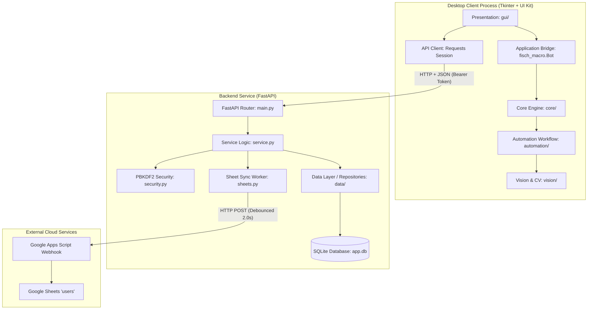

# Fisch Macro — ระบบสมาชิกและระบบช่วยเหลืออัตโนมัติ (Desktop Automation & Authentication System)

[](https://github.com/69030304-bot/fisch_macro/actions)
[](https://www.python.org/)
[](LICENSE)
[](docs/TEST_REPORT.md)

โปรเจกต์พัฒนาระบบสมาชิกและโปรแกรมช่วยเหลืออัตโนมัติบนเดสก์ท็อปแบบครบวงจร: **สมัครสมาชิก → ล็อกอินยืนยันตัวตน → แอปพลิเคชันเดสก์ท็อป → ตรวจจับภาพและควบคุมด้วยความแม่นยำสูง → ผู้ดูแลจัดการบัญชี → ซิงค์ข้อมูลขึ้น Google Sheets อัตโนมัติ**

---

## 1. คณะผู้จัดทำ (Team Members & Roles)

| รหัสนักศึกษา | ชื่อ-นามสกุล | หน้าที่ความรับผิดชอบ (Role) | กิ่งที่รับผิดชอบ |
|---|---|---|---|
| **69030304** | นายชยภัทร พุทธศรีเมือง | Python Application & Automation Core | `team/69030304-python-automation` |
| **69030208** | นายฤทธิพร วงค์ป้อม | GUI & Database Integration | `team/69030208-gui-db` |
| **69030377** | นางสาวพิชชาภา ภูววิไลเมธา | UX / UI Design | `team/69030377-ux-ui` |
| **69030343** | นายธีระนิตย์ บุญทวี | Backend & Database Developer | `team/69030343-backend-db` |
| **69030450** | นายกิตติศักดิ์ พัฒนนิติศักดิ์ | QA & Documentation | `team/69030450-qa-docs` |

---

## 2. สถาปัตยกรรมระบบ (System Architecture)

ระบบถูกออกแบบตามสถาปัตยกรรมแบบแยกเลเยอร์ (Layered Architecture with Event-Driven Decoupling):



**หลักการความปลอดภัยสำคัญ:** Desktop Client จะไม่เชื่อมต่อฐานข้อมูลตรงๆ เพื่อป้องกันการรั่วไหลของข้อมูลและสิทธิ์ การเรียกดูหรือแก้ไขข้อมูลต้องผ่านการยืนยันตัวตนด้วย Bearer Token ผ่าน FastAPI Backend เสมอ

---

## 3. โครงสร้างโฟลเดอร์โครงการ (Directory Structure)

```
fisch-project/
├── .github/workflows/       # GitHub Actions Continuous Integration (CI)
│   └── ci.yml
├── core/                    # Core Macro Engine, State Machine, EventBus, Input Abstraction
│   ├── engine.py            # MacroEngine ควบคุมวงจรชีวิตของบอท
│   ├── state.py             # StateManager จัดการสถานะ (IDLE, STARTING, RUNNING, STOPPED, ERROR)
│   ├── events.py            # EventBus ระบบ Publish/Subscribe แบบ Thread-safe
│   ├── task.py              # CancellationToken สำหรับการยกเลิกแบบประสานงาน
│   └── input.py             # InputManager ครอบคลุม Win32 SendInput และ MockInputDriver
├── automation/              # Fishing Automation Operations & Control Algorithms
│   ├── controller.py        # ReelController (PD Control) & SigmaDeltaModulator
│   ├── operations.py        # CastOperation, BiteWaitOperation, ReelOperation, EquipRodOperation
│   └── workflow.py          # FishingWorkflow ลูปการทำงานการตกปลาแบบครบวงจร
├── vision/                  # Screen Capture, Computer Vision & Tracking
│   ├── capture.py           # ScreenGrabber (mss.MSS / PIL fallback / MockScreenGrabber)
│   ├── detection.py         # color_mask, runs_of, choose, measure, analyze, detect
│   └── tracking.py          # Track (EMA predictive latency compensation)
├── data/                    # Data Layer, Models, Repositories, Database Pool & Config
│   ├── models.py            # strongly typed dataclasses: User, Session, LoginLog
│   ├── database.py          # DatabaseManager ทรานแซกชัน, foreign keys, migrations
│   ├── repositories.py      # UserRepository, SessionRepository, LogRepository
│   └── config.py            # ConfigManager บันทึก config แบบ atomic ป้องกันไฟล์เสีย
├── gui/                     # Presentation Layer (Tkinter + UI Kit)
│   ├── client.py            # ApiClient & run_bg ตัวเรียกงานเบื้องหลังแบบไม่บล็อก UI
│   ├── widgets.py           # Custom widgets (Tip tooltip, DateField 3 ดรอปดาวน์)
│   ├── auth_window.py       # LoginWindow (Sign In, Register, Forgot Password)
│   ├── admin_dialog.py      # AccountDialog แสดงข้อมูลผู้ใช้และตารางจัดการสำหรับ Admin
│   └── dashboard.py         # MacroDashboard หน้าต่างหลักพร้อมพรีวิวกล้องและสถิติสด
├── tests/                   # Automated Test Suites (53 Pytest Tests)
│   ├── test_automation.py   # ทดสอบตรรกะควบคุมและ Operations
│   ├── test_core.py         # ทดสอบ State machine, EventBus, CancellationToken, Mock Input
│   ├── test_database.py     # ทดสอบ SQLite transactions, cascades, migrations, config
│   ├── test_gui.py          # ทดสอบ GUI client, DateField, async dispatch, mock dashboard
│   ├── test_integration.py  # ทดสอบ End-to-End Interop ข้ามโมดูลทั้งหมด
│   ├── test_performance.py  # Benchmarks: Vision FPS, Control Latency, DB Query, Memory
│   ├── test_service_compat.py
│   ├── test_vision.py
│   └── test_vision_math.py
├── docs/                    # Full Project Documentation
│   ├── ARCHITECTURE.md      # เอกสารสถาปัตยกรรมระบบและ Diagram
│   ├── FEATURES.md          # ตารางติดตามฟีเจอร์ของระบบ
│   ├── PROJECT_AUDIT.md     # รายงานการตรวจสอบโค้ดเบื้องต้น
│   ├── ROADMAP.md           # แผนการพัฒนา Phase 0 ถึง Phase 9
│   ├── TEAM_ROLES.md        # การกระจายงานและหน้าที่ของสมาชิกทั้ง 5 คน
│   ├── TEST_REPORT.md       # รายงานผลการทดสอบและผลลัพธ์ Benchmark
│   └── UI_SPEC.md           # ข้อกำหนดการออกแบบ UI Design Tokens
├── fisch_macro.py           # จุดเริ่มต้นหลักของ Desktop Application (Façade 375 บรรทัด)
├── main.py                  # จุดเริ่มต้นของ Backend Server (FastAPI)
├── service.py               # Business Logic สำหรับระบบสมาชิก
├── database.py              # Root database facade
├── security.py              # PBKDF2 Hashing และ Token Generator
├── sheets.py                # ระบบ Background Worker ซิงค์ Google Sheets
├── view_database.py         # GUI Tool สำหรับเปิดดูและรันคำสั่ง SQL บน app.db
├── setup.bat                # สคริปต์ติดตั้ง Python venv และ dependencies ในคลิกเดียว
├── start_backend.bat        # สคริปต์เริ่มเซิร์ฟเวอร์ Backend
├── start_app.bat            # สคริปต์เริ่มแอปเดสก์ท็อป
├── view_database.bat        # สคริปต์เปิดเครื่องมือดูฐานข้อมูล
├── test_service.py          # สคริปต์ทดสอบ Backend Standalone (10/10 PASS)
├── USER_GUIDE.md            # คู่มือการใช้งานสำหรับผู้ใช้ทั่วไป
└── CHANGELOG.md             # ประวัติการปรับปรุงและการเปลี่ยนแปลง v1.0.0
```

---

## 4. เริ่มต้นใช้งานแบบเร่งด่วน (Quick Start)

### วิธีที่ 1: ใช้งานผ่าน Batch Scripts บน Windows (แนะนำ)
1. **ติดตั้งครั้งแรก:** ดับเบิลคลิก **`setup.bat`** (ติดตั้ง Python venv และไลบรารีให้อัตโนมัติ)
2. **เปิดเซิร์ฟเวอร์:** ดับเบิลคลิก **`start_backend.bat`** (เปิดทิ้งไว้)
3. **เปิดแอป:** ดับเบิลคลิก **`start_app.bat`** (เข้าสู่ระบบและเริ่มใช้งาน)
4. **ดูฐานข้อมูล:** ดับเบิลคลิก **`view_database.bat`** (ดูข้อมูลสมาชิก)

### วิธีที่ 2: รันผ่าน Command Line / Terminal
```bash
# 1. ติดตั้ง dependencies
pip install -r requirements.txt

# 2. รันเซิร์ฟเวอร์ Backend (เปิด terminal ที่ 1)
python main.py

# 3. รันแอปพลิเคชัน Desktop Macro (เปิด terminal ที่ 2)
python fisch_macro.py
```

---

## 5. การรันชุดทดสอบอัตโนมัติ (Automated Testing)

โครงการมีชุดทดสอบครอบคลุมทุกโมดูลรวม **63 Test Cases** (100% ผ่านทุกการทดสอบ):

```bash
# รันชุดทดสอบ Pytest ทั้งหมด (53 tests)
pytest tests/ -v

# รันชุดทดสอบ Backend Standalone (10 tests)
python test_service.py
```

### ผลลัพธ์ Performance Benchmark:
- **Vision Pipeline Throughput:** **~1,220 FPS** (รองรับการประมวลผลวิดีโอระดับ Real-time)
- **Control Computation Latency:** **~1.32 ไมโครวินาที (µs)** ต่อการคำนวณ 1 ลูป
- **Database Indexed Query Latency:** **~0.18 มิลลิวินาที (ms)** ต่อคำขอ
- **Memory Growth:** **< 0.15 MB** ตลอดการจำลองลูปตกปลาต่อเนื่อง (Zero Memory Leak)

อ่านรายงานการทดสอบฉบับเต็มได้ที่ [docs/TEST_REPORT.md](docs/TEST_REPORT.md)

---

## 6. รายการ API Endpoints (FastAPI Backend)

| Method | Path | สิทธิ์ | คำอธิบาย |
|---|---|---|---|
| `GET` | `/health` | สาธารณะ | ตรวจสอบสถานะการทำงานของเซิร์ฟเวอร์ |
| `POST` | `/register` | สาธารณะ | สมัครสมาชิก (คนแรกจะได้สิทธิ์ Admin อัตโนมัติ) |
| `POST` | `/login` | สาธารณะ | เข้าสู่ระบบ และรับ Bearer Token (หมดอายุ 12 ชั่วโมง) |
| `POST` | `/password/reset` | สาธารณะ | กู้คืนรหัสผ่านด้วย Nickname + Birthday |
| `GET` | `/me` | สมาชิก | ข้อมูลผู้ใช้ปัจจุบัน (ใช้เป็น Client Heartbeat) |
| `POST` | `/logout` | สมาชิก | ยกเลิก Token ของเซสชันปัจจุบัน |
| `POST` | `/change-password` | สมาชิก | เปลี่ยนรหัสผ่านของตนเอง |
| `GET` | `/admin/users` | Admin | ดึงรายชื่อผู้ใช้ทั้งหมดในระบบ |
| `POST` | `/admin/users/{id}/active` | Admin | ระงับ / เปิดใช้งานบัญชีผู้ใช้ |
| `POST` | `/admin/users/{id}/reset-password` | Admin | รีเซ็ตรหัสผ่านให้สมาชิก |
| `DELETE` | `/admin/users/{id}` | Admin | ลบบัญชีผู้ใช้พร้อมยกเลิกเซสชัน |
| `POST` | `/admin/sync-sheet` | Admin | สั่งซิงค์ข้อมูลไปยัง Google Sheet ทันที |

---

## 7. เอกสารอ้างอิงของโครงการ

- 📖 **คู่มือการใช้งาน:** [USER_GUIDE.md](USER_GUIDE.md)
- 📐 **สถาปัตยกรรมระบบ:** [docs/ARCHITECTURE.md](docs/ARCHITECTURE.md)
- 🧪 **รายงานผลการทดสอบ:** [docs/TEST_REPORT.md](docs/TEST_REPORT.md)
- 🎨 **สเปกการออกแบบ UX/UI:** [docs/UI_SPEC.md](docs/UI_SPEC.md)
- 📋 **ประวัติการปรับปรุง:** [CHANGELOG.md](CHANGELOG.md)
- 🧭 **แผนผัง Roadmap:** [docs/ROADMAP.md](docs/ROADMAP.md)
