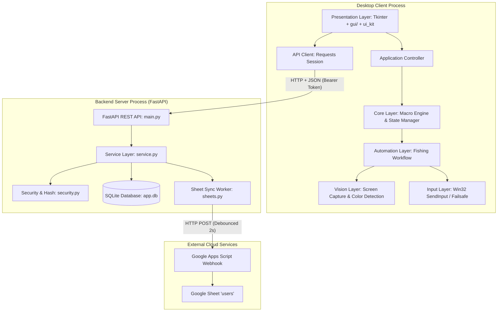
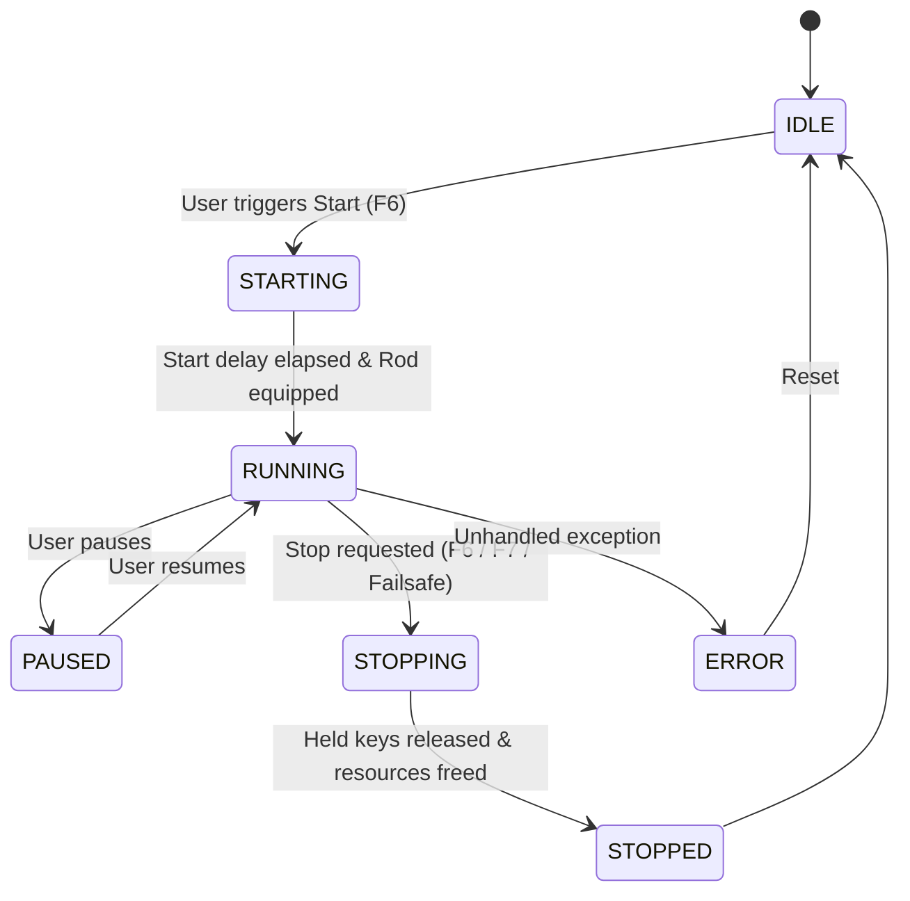
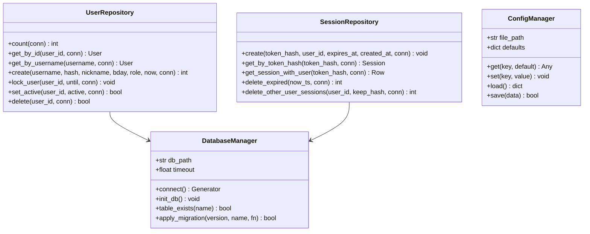
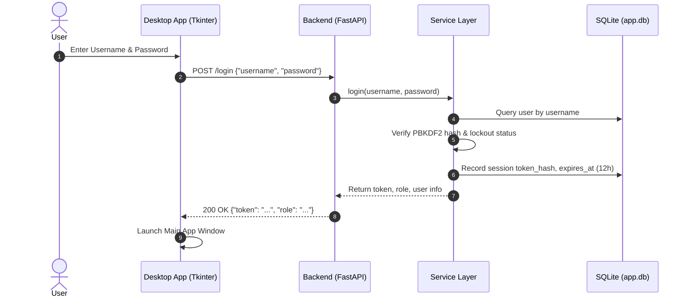
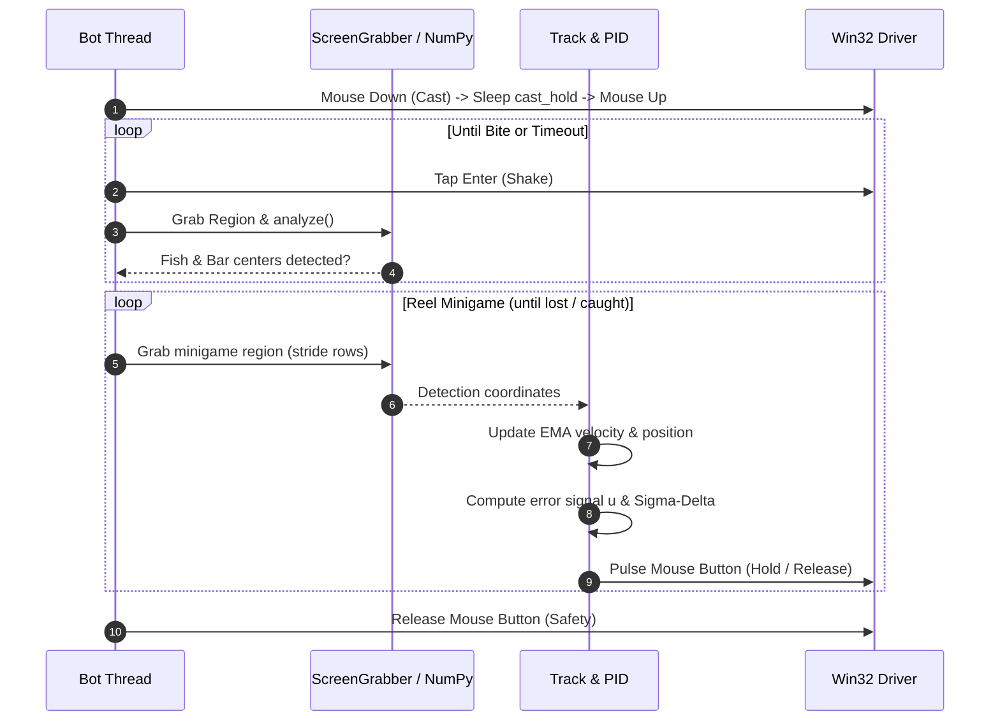

# ARCHITECTURE.md — System Architecture & Design Specification

**Project:** Fisch Macro  
**Platform:** Windows Desktop Application  
**Architectural Paradigm:** Layered Architecture with Event-Driven Decoupling  
**Primary Subsystem Owners:**  
- Core & Automation: 69030304  
- GUI & DB Integration: 69030208  
- UX/UI Design: 69030377  
- Backend & Database: 69030343  
- QA & Documentation: 69030450  

---

## 1. System Overview

Fisch Macro is an automated desktop assistant for the Roblox game *Fisch*. The system comprises two interconnected subsystems:
1. **Desktop Client Subsystem**: A desktop GUI application providing macro automation, calibration, telemetry, and member account management.
2. **Backend Authentication & Data Subsystem**: A FastAPI web service providing persistent authentication, role-based security, access auditing, and external data synchronization to Google Sheets.

---

## 2. Layered Architecture & Responsibilities

### 2.1 Presentation Layer (`gui/`)
- **Primary Owner:** 69030208 (GUI Implementation)  
- **Collaborator:** 69030377 (UX/UI Design)
- **Components:**
  - `gui.client`: `ApiClient` handling session persistence, authentication headers, error wrapping, client configuration (`load_client_cfg`, `save_client_cfg`), and asynchronous task execution (`run_bg`).
  - `gui.widgets`: Reusable UI elements including hover tooltip `Tip` and leap-year validated 3-dropdown `DateField`.
  - `gui.auth_window.LoginWindow`: Authentication portal for Sign In, Registration, and Nickname/Birthday Password Reset using theme `LOGIN` (Peach/Indigo palette).
  - `gui.dashboard.MacroDashboard` (aliased as `App`): Modern control dashboard with live session telemetry, header stat cards, real-time camera preview, fullscreen loupe calibration overlay, two-way slider settings, and tag-colored console logs.
  - `gui.admin_dialog.AccountDialog`: Profile management modal featuring self password change, admin user table (`ttk.Treeview`), one-click account suspension toggle, administrative password reset, and Google Sheets sync trigger.
  - `ui_kit.py`: Anti-aliased canvas rendering library (`GButton`, `Card`, `StatCard`, `Chip`, `PillTabs`, `Toggle`, `GSlider`, `RoundEntry`, `RoundCombo`).
  - `fisch_macro.py`: Slim façade (414 lines) maintaining backward compatibility for external scripts, importing components from `gui/`, `core/`, `automation/`, `vision/`, and `data/`.
- **Invariants:**
  - Must never directly invoke blocking automation or networking calls on the Tkinter main thread; all REST calls dispatch asynchronously via `run_bg`.
  - Bot lifecycle is decoupled: `MacroDashboard` accepts an optional `bot_factory` parameter, enabling mock injection during automated testing.
  - Configuration persistence utilizes atomic `ConfigManager` from `data.config`.

### 2.2 Application Layer (`app/`)
- **Primary Owner:** 69030304 (Python Application)
- **Collaborator:** 69030450 (QA / Docs)
- **Components:**
  - `ApplicationController`: Coordinates UI events with macro engine lifecycles.
  - `HotkeyManager`: Manages global keybinds (F6, F7, F8) safely with background thread routing.
  - `HeartbeatWorker`: Periodic client session validity check against `/me`.
  - `ConfigManager`: Manages persistence of `fisch_config.json` and `fisch_client.json`.

### 2.3 Core Layer (`core/`)
- **Primary Owner:** 69030304 (Automation Engine)
- **Collaborator:** 69030450 (QA / Docs)
- **Components:**
  - `MacroEngine`: Orchestrates task execution, cancellation, and thread management.
  - `StateManager`: Thread-safe state transition manager enforcing macro lifecycle invariants.
  - `EventBus`: Decoupled publish-subscribe mechanism for log messages, state notifications, and telemetry.

#### Macro State Machine:

### 2.4 Automation Layer (`automation/`)
- **Primary Owner:** 69030304 (Automation Core)
- **Components:**
  - `FishingWorkflow`: The sequential fishing loop:
    1. **Cast**: Hold left mouse button for `cast_hold` seconds.
    2. **Wait / Shake**: Tap `Enter` repeatedly, optionally toggle UI Navigation (`\`), monitor for minigame appearance within `bite_timeout`.
    3. **Reel**: Track fish and reel bar positions across frames, compute PD error signal, generate sigma-delta mouse input pulses until minigame finishes or `reel_timeout` expires.
    4. **Rest**: Pause for `loop_delay` seconds before repeating.
  - `Controller`: Evaluates position error $e = (x_{fish} - x_{bar}) / \text{half\_bar}$ and relative velocity $e_v = (v_{fish} - v_{bar}) / \text{half\_bar}$ to produce continuous control value $u \in [0.0, 1.0]$.
  - `SigmaDeltaModulator`: Converts continuous signal $u$ into discrete, high-frequency mouse clicks at ~6ms intervals.

### 2.5 Vision Layer (`vision/`)
- **Primary Owner:** 69030304
- **Components:**
  - `ScreenGrabber`: Hardware-accelerated screen capture via `mss`, falling back to `PIL.ImageGrab`.
  - `ColorFilter`: Vectorized RGB mask calculation with NumPy broadcasting across pixel matrices.
  - `RunLengthClusterer`: Groups contiguous active columns (`runs_of`) allowing gaps for occlusion (`BAR_GAP`, `FISH_GAP`).
  - `ObjectTracker`: Multi-frame predictive position estimator (`Track`) using Exponential Moving Average (EMA) with time constant $\tau = 0.05s$.

### 2.6 Input Layer (`input/`)
- **Primary Owner:** 69030304
- **Components:**
  - `InputManager`: High-level mouse and keyboard simulation.
  - `Win32Driver`: Direct Win32 `SendInput` hardware scan-code implementation.
  - `FailsafeMonitor`: Hardware-level watchdog stopping automation immediately when mouse reaches (0, 0).
  - `InputCleanup`: Safety handler guaranteeing all pressed mouse buttons and held keys are released on shutdown or abort.

### 2.7 Data Layer (`data/` & Backend)
- **Primary Owner:** 69030343 (Backend & Database)
- **Collaborator:** 69030208 (GUI Integration)
- **Components:**
  - `data.models`: Strongly typed dataclasses (`User`, `Session`, `LoginLog`) providing `from_row()`, `to_dict()`, and public representation helpers.
  - `data.database`: `DatabaseManager` providing transactional context management (`PRAGMA foreign_keys = ON`), automatic rollback on failure, dynamic path resolution, and non-destructive migration execution (`apply_migration()`).
  - `data.repositories`: Repository pattern decoupling SQL from business logic:
    - `UserRepository`: Account CRUD, case-insensitive lookups, failed attempts, and exponential lockouts.
    - `SessionRepository`: Token hash management, expired token pruning, user session cascade cleanup.
    - `LogRepository`: IP and timestamp audit tracking.
  - `data.config`: `ConfigManager` providing atomic tempfile+fsync writes, schema defaults, and corrupted file auto-recovery (`.corrupted` backup).
  - `database.py`: Root compatibility facade delegating to `data.database`.
  - `security.py`: PBKDF2-HMAC-SHA256 password hashing (200,000 iterations), dummy timing-attack mitigation hash, cryptographically secure token generation (`secrets.token_urlsafe`).
  - `sheets.py`: Background worker aggregating updates and pushing debounced (2.0s) snapshots to Google Sheets with graceful thread shutdown.

---

## 3. Data Flow & Communication Contracts

### 3.1 Client-Backend Authentication Flow

### 3.2 Fishing Loop Data Flow

---

## 4. Architectural Boundaries and Invariants

1. **Client Never Accesses Database Directly**: The desktop macro application connects to the SQLite database strictly through the FastAPI REST interface (`ApiClient`). No direct SQLite connections exist from the desktop app.
2. **Platform Abstraction**: Windows-specific Win32 calls (`ctypes.windll`) must be encapsulated within an adapter pattern so core logic, vision algorithms, and backend services can be tested headlessly on macOS/Linux.
3. **Emergency Stop Precedence**: Failsafe mechanisms (F7 hotkey, (0, 0) cursor coordinate) take instantaneous priority over any queued automation operation and must guarantee input release.
4. **Data Privacy**: Passwords, password hashes, and session tokens are strictly excluded from Google Sheet exports and log files.
