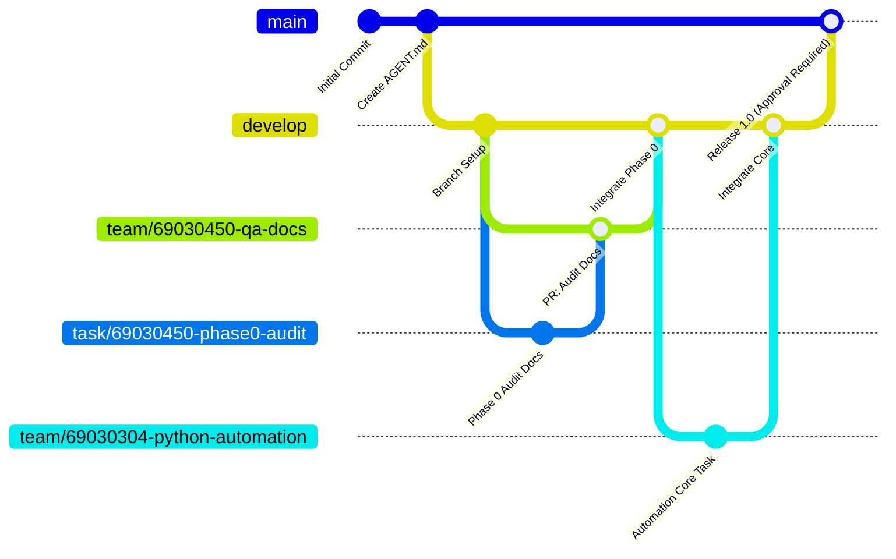

# BRANCH_STRATEGY.md — Git Branching, Integration, and Release Strategy

**Project:** Fisch Macro  
**Model:** Multi-Member Feature Branch Workflow with Protected Production  
**Default Base Branch:** `develop`  
**Protected Release Branch:** `main`  

---

## 1. Branch Topology



---

## 2. Branch Hierarchy and Rules

### 2.1 `main` (Production / Release)
- **Purpose:** Stable, production-ready releases.
- **Rules:**
  - **NEVER** commit directly to `main`.
  - **NEVER** push directly to `main`.
  - **NEVER** merge into `main` without explicit project maintainer / user approval.
  - Releases are tagged with semantic versioning (`v1.0.0`, `v1.0.1`).

### 2.2 `develop` (Integration Branch)
- **Purpose:** Main integration base where verified features from all team members converge.
- **Rules:**
  - Receives completed work from team branches via Pull Requests.
  - All automated tests must pass before merging into `develop`.
  - Serves as the base for new team branches and release staging.

### 2.3 Team Branches (Long-Lived Member Branches)
Dedicated branch for each team member:
- `team/69030450-qa-docs` (QA, Testing, Documentation)
- `team/69030377-ux-ui` (UX/UI Design)
- `team/69030343-backend-db` (Backend & Database)
- `team/69030304-python-automation` (Python Application & Automation Core)
- `team/69030208-gui-db` (GUI Implementation & DB Integration)

**Rules:**
- Each member works exclusively within their designated team branch or branched task branches.
- Members must pull/rebase against `develop` regularly to resolve integration conflicts early.

### 2.4 Task Branches (Short-Lived Feature / Fix Branches)
Created from the respective member's team branch or agreed integration base.

**Naming Convention:**
```
<type>/<member_id>-<description>
```
Types:
- `feature/` : New capabilities or component implementations.
- `refactor/` : Code restructuring without changing behavior.
- `fix/` : Bug fixes and regression repairs.
- `test/` : Test suite creation and test harness enhancements.
- `docs/` : Documentation creation and updates.
- `task/` : Multi-faceted milestone or audit tasks.

**Examples:**
- `task/69030450-phase0-audit`
- `feature/69030304-macro-engine`
- `refactor/69030304-core-architecture`
- `feature/69030343-database-schema`
- `feature/69030208-gui-components`
- `fix/69030450-regression-tests`
- `docs/69030450-user-manual`

---

## 3. Pull Request & Integration Lifecycle

1. **Local Work:**
   - Create task branch from team branch:
     ```bash
     git checkout -b feature/69030304-macro-engine team/69030304-python-automation
     ```
   - Implement incrementally, writing tests and verifying diffs.
2. **Pre-Commit Verification:**
   - Run tests: `.venv/bin/python test_service.py` (and test suite).
   - Review staged changes: `git diff --staged`.
3. **Commit Standards:**
   - Commit messages must follow Conventional Commits:
     ```
     <type>: <concise description in imperative mood>

     [optional detailed body]
     ```
     Examples:
     - `docs: add Phase 0 repository audit and architecture plan`
     - `feat: decouple macro engine from Tkinter UI`
     - `test: add unit tests for horizontal run length clustering`
4. **Integration into Team Branch:**
   - Test thoroughly, merge task branch into member branch.
5. **Integration into `develop`:**
   - Open Pull Request targeting `develop`.
   - Include:
     - Purpose of changes.
     - Files modified.
     - Tests executed and actual results.
     - Known issues or limitations.
   - Requires verification by QA (69030450) and subsystem owner.
6. **Release to `main`:**
   - Explicit user approval required.
   - Tag release commit.

---

## 4. Current Repository Branch Status

| Branch | Tracking Remote | Current HEAD | Purpose |
|---|---|---|---|
| `main` | `origin/main` | `49f746d` | Production release |
| `develop` | Local (ready to push) | `49f746d` | Team integration |
| `team/69030450-qa-docs` | Local (ready to push) | `49f746d` | Member 69030450 base |
| `team/69030377-ux-ui` | Local (ready to push) | `49f746d` | Member 69030377 base |
| `team/69030343-backend-db` | Local (ready to push) | `49f746d` | Member 69030343 base |
| `team/69030304-python-automation` | Local (ready to push) | `49f746d` | Member 69030304 base |
| `team/69030208-gui-db` | Local (ready to push) | `49f746d` | Member 69030208 base |
| `task/69030450-phase0-audit` | Active Working Branch | `49f746d` | Phase 0 audit & baseline documentation |
