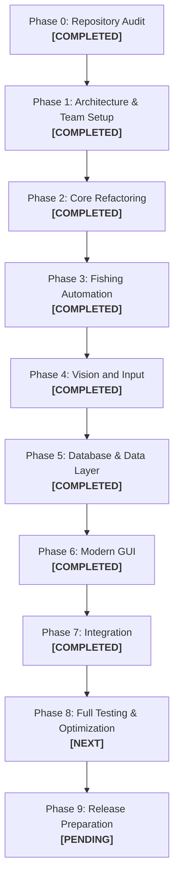

# ROADMAP.md — Project Roadmap and Development Phases

**Project:** Fisch Macro  
**Strategy:** Preserve & Refactor (Incremental Modular Evolution)  
**Current Phase:** Phase 7 — Integration (COMPLETED) ➔ Next: Phase 8 (Full Testing & Optimization)  
**Last Updated:** 2026-11-11  

---

## 1. Development Phase Overview

---

## 2. Phase Details & Status

### Phase 0 — Repository Audit
- **Status:** **COMPLETED**
- **Lead Member:** 69030450 (QA & Documentation)
- **Objectives:**
  - Inspect existing codebase, directory structure, and dependencies.
  - Audit existing features and compare against project specifications.
  - Run baseline automated tests (`test_service.py`).
  - Identify technical debt, platform limitations, and architectural risks.
- **Deliverables:**
  - `docs/PROJECT_AUDIT.md` (Complete)
  - `docs/FEATURES.md` (Complete)
- **Outcome:** Baseline tests passed (10/10). Identified unshielded Win32 `ctypes` imports and monolithic coupling in `fisch_macro.py`.

---

### Phase 1 — Architecture and Team Setup
- **Status:** **COMPLETED**
- **Lead Member:** 69030450 / All Members
- **Objectives:**
  - Document target modular system architecture.
  - Map five team members' subsystem responsibilities.
  - Establish Git branch topology (`main`, `develop`, team branches, task branches).
  - Define shared module interfaces and data contracts.
- **Deliverables:**
  - `docs/ARCHITECTURE.md` (Complete)
  - `docs/TEAM_ROLES.md` (Complete)
  - `docs/BRANCH_STRATEGY.md` (Complete)
  - `docs/ROADMAP.md` (Complete)
  - `HANDOFF.md` & `PHASE-LOG.md` (Complete)

---

### Phase 2 — Core Refactoring
- **Status:** **COMPLETED**
- **Lead Member:** 69030304 (Python Application & Automation)
- **Collaborator:** 69030450 (QA / Docs)
- **Objectives:**
  - Abstract application lifecycle from Tkinter event loop.
  - Implement decoupled `StateManager` (`IDLE`, `STARTING`, `RUNNING`, `PAUSED`, `STOPPING`, `STOPPED`, `ERROR`).
  - Introduce thread-safe `EventBus` for cross-module communication.
  - Implement cooperative task cancellation and interruptible sleep (`CancellationToken`).
  - Encapsulate `ctypes.windll` behind `InputManager` with platform guards and `MockInputDriver`.
  - Author automated unit tests for `core` and vision math algorithms.
- **Deliverables:**
  - `core/` package (`state.py`, `events.py`, `task.py`, `input.py`, `engine.py`, `__init__.py`).
  - `tests/test_core.py` (9 tests, 100% pass).
  - `tests/test_vision_math.py` (5 tests, 100% pass).
  - `tests/test_service_compat.py` (10 tests, 100% pass).
  - Total automated tests: 15/15 passing.

---

### Phase 3 — Fishing Automation
- **Status:** **COMPLETED**
- **Lead Member:** 69030304 (Python Application & Automation)
- **Collaborator:** 69030450 (QA / Regression)
- **Objectives:**
  - Decouple fishing operations into dedicated classes (`CastOperation`, `BiteWaitOperation`, `ReelOperation`, `EquipRodOperation`).
  - Modularize the control logic (`ReelController`, `SigmaDeltaModulator`) with unit tests.
  - Create high-level `FishingWorkflow` orchestrating the cyclic workflow.
  - Add regression tests covering control math, duty cycle modulation, operations, and workflow simulation.
- **Deliverables:**
  - `automation/` package (`controller.py`, `operations.py`, `workflow.py`, `__init__.py`).
  - `tests/test_automation.py` (8 tests, 100% pass).
  - Total automated test suite: 23/23 passing across all modules.

---

### Phase 4 — Vision and Input
- **Status:** **COMPLETED**
- **Lead Member:** 69030304 (Automation Core)
- **Collaborator:** 69030450 (QA / Testing)
- **Objectives:**
  - Create dedicated `vision/` package with `MssScreenGrabber`, `PilScreenGrabber`, and `MockScreenGrabber`.
  - Extract pure detection routines (`color_mask`, `runs_of`, `choose`, `analyze`, `measure`, `centers`, `row_stride`, `detect`).
  - Extract EMA predictive tracking into `vision.tracking.Track`.
  - Author automated unit tests for synthetic minigame frame detection and tracking.
- **Deliverables:**
  - `vision/` package (`capture.py`, `detection.py`, `tracking.py`, `__init__.py`).
  - `tests/test_vision.py` (5 tests, 100% pass).
  - Total automated test suite: 28/28 passing across all modules.

---

### Phase 5 — Database and Data Layer
- **Status:** **COMPLETED**
- **Lead Member:** 69030343 (Backend & Database)
- **Collaborator:** 69030208 (GUI & DB Integration)
- **Objectives:**
  - Create dedicated `data/` package (`models.py`, `database.py`, `repositories.py`, `config.py`).
  - Extract `UserRepository`, `SessionRepository`, `LogRepository` to decouple SQL from business logic.
  - Maintain SQLite schema integrity, foreign keys (`PRAGMA foreign_keys = ON`), and cascading deletes (`ON DELETE CASCADE`).
  - Implement non-destructive migration engine with `_schema_migrations` tracking.
  - Implement atomic configuration writing (`ConfigManager`) with automated fallback and `.corrupted` backup recovery.
  - Preserve 100% backward compatibility for all API routes, SQLite schema, `database.py`, and `service.py`.
- **Deliverables:**
  - `data/` package (`models.py`, `database.py`, `repositories.py`, `config.py`, `__init__.py`).
  - `tests/test_database.py` (8 automated test suites verifying transactions, cascades, migrations, repositories, and config).
  - Total automated test suite: 36/36 passing across all modules + 10/10 service compatibility tests.

---

### Phase 6 — Modern GUI
- **Status:** **COMPLETED**
- **Lead Member:** 69030208 (GUI Implementation)
- **Collaborator:** 69030377 (UX/UI Design)
- **Objectives:**
  - Create dedicated `gui/` package decoupling client networking, custom widgets, authentication modals, account dialogs, and macro dashboard.
  - Maintain modern aesthetic defined in `ui_kit.py` and documented in `docs/UI_SPEC.md`.
  - Ensure UI thread is never blocked by asynchronous background worker dispatch (`run_bg`).
  - Decouple bot lifecycle in `MacroDashboard` via dependency injection (`bot_factory`) to enable headless testing.
  - Slim down monolithic `fisch_macro.py` from 1,751 to 414 lines while keeping 100% backward compatibility for all external imports and scripts.
  - Author automated test suite in `tests/test_gui.py` covering client configuration, API client errors, DateField validation, async workers, log tagging, and mock bot lifecycle.
- **Deliverables:**
  - `gui/` package (`client.py`, `widgets.py`, `auth_window.py`, `admin_dialog.py`, `dashboard.py`, `__init__.py`).
  - `docs/UI_SPEC.md` (Comprehensive UX/UI specification).
  - `tests/test_gui.py` (6 automated unit tests).
  - Total automated test suite: 42/42 passing across all modules + 10/10 service compatibility tests.

---

### Phase 7 — Integration
- **Status:** **COMPLETED**
- **Lead Member:** All Members (Led by 69030304 Automation Core & 69030450 QA)
- **Objectives:**
  - Wire `MacroDashboard` and `fisch_macro.Bot` directly to `core.MacroEngine` and `automation.FishingWorkflow`.
  - Provide full dependency-injected testability with `MockScreenGrabber` and `MockInputDriver`.
  - Validate end-to-end user workflows (Registration -> Login -> Token Auth -> Dashboard -> Bot Fishing -> Emergency Stop -> Logout).
  - Create comprehensive integration test suite `tests/test_integration.py` (7/7 tests passing).
  - Verify standalone importability of all entrypoints (`main.py`, `fisch_macro.py`, `view_database.py`, `ui_kit.py`).
  - Eliminate all deprecation warnings and ensure zero-regression across all 49 pytest tests and 10 service tests.
- **Deliverables:**
  - Integrated `fisch_macro.Bot` delegating to `automation.FishingWorkflow`.
  - `tests/test_integration.py` (7 comprehensive cross-module tests).
  - Total automated test suite: 49/49 passing across all modules + 10/10 service compatibility tests (59 total).

---

### Phase 8 — Full Testing and Optimization
- **Status:** **NEXT**
- **Lead Member:** 69030450 (QA & Documentation)
- **Collaborator:** All Members
- **Objectives:**
  - Execute automated unit, integration, and regression test suites.
  - Perform memory profiling and idle/active CPU benchmark measurements.
  - Conduct live Windows manual test checklist.
  - Fix any identified regressions or edge-case bugs.

---

### Phase 9 — Release Preparation
- **Status:** **PENDING**
- **Lead Member:** 69030450 / Coordinator
- **Objectives:**
  - Validate one-click batch scripts (`setup.bat`, `start_app.bat`, `start_backend.bat`, `view_database.bat`).
  - Finalize documentation (`README.md`, `USER_GUIDE.md`, `CHANGELOG.md`).
  - Prepare presentation materials and demo script.
  - Request approval for release tag and integration into `main`.

---

## 3. Blockers and Critical Dependencies

| ID | Blocker / Dependency | Impacted Phases | Resolution Plan |
|---|---|---|---|
| **B-01** | Platform dependency (`ctypes.windll`) prevents headless automated tests on non-Windows dev environments. | Phase 2, Phase 4 | **RESOLVED**: Encapsulated in `core.input` with `MockInputDriver` and runtime platform detection. |
| **B-02** | Roblox client requirement for live fishing verification. | Phase 3, Phase 4, Phase 8 | Develop synthetic frame replay harness using historical snapshots / `fisch_trace.csv`. |
| **B-03** | Approval required before any merge into `main`. | Phase 9 | Maintain strict branching: all PRs target `develop`; maintainer explicitly approves `main`. |
