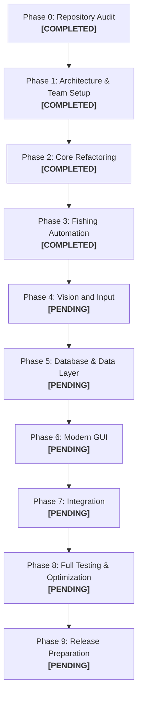

# ROADMAP.md — Project Roadmap and Development Phases

**Project:** Fisch Macro  
**Strategy:** Preserve & Refactor (Incremental Modular Evolution)  
**Current Phase:** Phase 3 — Fishing Automation (COMPLETED) ➔ Next: Phase 4 (Vision and Input)  
**Last Updated:** 2026-11-11  

---

## 1. Development Phase Overview

---

## 2. Phase Details & Status

### Phase 0 — Repository Audit
- **Status:** **COMPLETED**
- **Lead Member:** 69030450 (QA & Documentation)
- **Objectives:**
  - Inspect existing codebase, directory structure, and dependencies.
  - Audit existing features and compare against project specifications.
  - Run baseline automated tests (`test_service.py`).
  - Identify technical debt, platform limitations, and architectural risks.
- **Deliverables:**
  - `docs/PROJECT_AUDIT.md` (Complete)
  - `docs/FEATURES.md` (Complete)
- **Outcome:** Baseline tests passed (10/10). Identified unshielded Win32 `ctypes` imports and monolithic coupling in `fisch_macro.py`.

---

### Phase 1 — Architecture and Team Setup
- **Status:** **COMPLETED**
- **Lead Member:** 69030450 / All Members
- **Objectives:**
  - Document target modular system architecture.
  - Map five team members' subsystem responsibilities.
  - Establish Git branch topology (`main`, `develop`, team branches, task branches).
  - Define shared module interfaces and data contracts.
- **Deliverables:**
  - `docs/ARCHITECTURE.md` (Complete)
  - `docs/TEAM_ROLES.md` (Complete)
  - `docs/BRANCH_STRATEGY.md` (Complete)
  - `docs/ROADMAP.md` (Complete)
  - `HANDOFF.md` & `PHASE-LOG.md` (Complete)

---

### Phase 2 — Core Refactoring
- **Status:** **COMPLETED**
- **Lead Member:** 69030304 (Python Application & Automation)
- **Collaborator:** 69030450 (QA / Docs)
- **Objectives:**
  - Abstract application lifecycle from Tkinter event loop.
  - Implement decoupled `StateManager` (`IDLE`, `STARTING`, `RUNNING`, `PAUSED`, `STOPPING`, `STOPPED`, `ERROR`).
  - Introduce thread-safe `EventBus` for cross-module communication.
  - Implement cooperative task cancellation and interruptible sleep (`CancellationToken`).
  - Encapsulate `ctypes.windll` behind `InputManager` with platform guards and `MockInputDriver`.
  - Author automated unit tests for `core` and vision math algorithms.
- **Deliverables:**
  - `core/` package (`state.py`, `events.py`, `task.py`, `input.py`, `engine.py`, `__init__.py`).
  - `tests/test_core.py` (9 tests, 100% pass).
  - `tests/test_vision_math.py` (5 tests, 100% pass).
  - `tests/test_service_compat.py` (10 tests, 100% pass).
  - Total automated tests: 15/15 passing.

---

### Phase 3 — Fishing Automation
- **Status:** **COMPLETED**
- **Lead Member:** 69030304 (Python Application & Automation)
- **Collaborator:** 69030450 (QA / Regression)
- **Objectives:**
  - Decouple fishing operations into dedicated classes (`CastOperation`, `BiteWaitOperation`, `ReelOperation`, `EquipRodOperation`).
  - Modularize the control logic (`ReelController`, `SigmaDeltaModulator`) with unit tests.
  - Create high-level `FishingWorkflow` orchestrating the cyclic workflow.
  - Add regression tests covering control math, duty cycle modulation, operations, and workflow simulation.
- **Deliverables:**
  - `automation/` package (`controller.py`, `operations.py`, `workflow.py`, `__init__.py`).
  - `tests/test_automation.py` (8 tests, 100% pass).
  - Total automated test suite: 23/23 passing across all modules.

---

### Phase 4 — Vision and Input
- **Status:** **PENDING**
- **Lead Member:** 69030304 (Automation Core)
- **Collaborator:** 69030450 (QA / Testing)
- **Objectives:**
  - Separate `ScreenGrabber` interface with `mss` and `PIL` adapters.
  - Extract pure vision functions (`color_mask`, `runs_of`, `choose`) into a testable `vision` module.
  - Create input driver abstraction (`Win32InputDriver` and `MockInputDriver`).
  - Test input cleanup and emergency stop guarantees.

---

### Phase 5 — Database and Data Layer
- **Status:** **PENDING**
- **Lead Member:** 69030343 (Backend & Database)
- **Collaborator:** 69030208 (GUI & DB Integration)
- **Objectives:**
  - Refine data models and validation in `service.py`.
  - Maintain SQLite schema integrity, foreign keys, and cascading rules.
  - Preserve existing user database compatibility without data loss.
  - Verify Google Sheet background sync reliability and error handling.

---

### Phase 6 — Modern GUI
- **Status:** **PENDING**
- **Lead Member:** 69030208 (GUI Implementation)
- **Collaborator:** 69030377 (UX/UI Design)
- **Objectives:**
  - Connect GUI strictly to `ApplicationController` and `EventBus` (no direct bot coupling).
  - Maintain modern aesthetic defined in `ui_kit.py`.
  - Polish dashboard responsive scaling, settings widgets, and telemetry graphs.
  - Ensure UI thread is never blocked by background operations.

---

### Phase 7 — Integration
- **Status:** **PENDING**
- **Lead Member:** All Members
- **Objectives:**
  - Assemble modular layers into unified desktop application.
  - Validate end-to-end user workflows (Registration -> Login -> Calibration -> Fishing -> Logout).
  - Execute full cross-module integration tests on `develop`.
  - Maintain backwards compatibility with existing configuration files.

---

### Phase 8 — Full Testing and Optimization
- **Status:** **PENDING**
- **Lead Member:** 69030450 (QA & Documentation)
- **Collaborator:** All Members
- **Objectives:**
  - Execute automated unit, integration, and regression test suites.
  - Perform memory profiling and idle/active CPU benchmark measurements.
  - Conduct live Windows manual test checklist.
  - Fix any identified regressions or edge-case bugs.

---

### Phase 9 — Release Preparation
- **Status:** **PENDING**
- **Lead Member:** 69030450 / Coordinator
- **Objectives:**
  - Validate one-click batch scripts (`setup.bat`, `start_app.bat`, `start_backend.bat`, `view_database.bat`).
  - Finalize documentation (`README.md`, `USER_GUIDE.md`, `CHANGELOG.md`).
  - Prepare presentation materials and demo script.
  - Request approval for release tag and integration into `main`.

---

## 3. Blockers and Critical Dependencies

| ID | Blocker / Dependency | Impacted Phases | Resolution Plan |
|---|---|---|---|
| **B-01** | Platform dependency (`ctypes.windll`) prevents headless automated tests on non-Windows dev environments. | Phase 2, Phase 4 | **RESOLVED**: Encapsulated in `core.input` with `MockInputDriver` and runtime platform detection. |
| **B-02** | Roblox client requirement for live fishing verification. | Phase 3, Phase 4, Phase 8 | Develop synthetic frame replay harness using historical snapshots / `fisch_trace.csv`. |
| **B-03** | Approval required before any merge into `main`. | Phase 9 | Maintain strict branching: all PRs target `develop`; maintainer explicitly approves `main`. |
