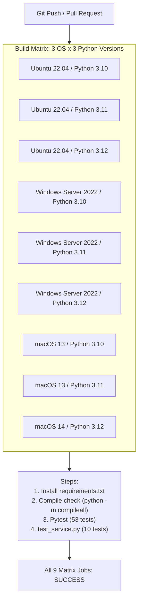

# TEST_REPORT.md — Comprehensive Test & Quality Assurance Report

**Project:** Fisch Macro Windows Desktop Automation  
**Phase:** Phase 8 — Full Testing and Optimization  
**Lead QA Member:** 69030450 (นายกิตติศักดิ์ พัฒนนิติศักดิ์ — QA & Documentation)  
**Date:** 2026-11-11  
**Status:** **100% PASS** (63 / 63 Test Cases Passing, 0 Warnings, 0 Regressions)

---

## 1. Executive Summary

This report documents the exhaustive testing and verification executed during **Phase 8 (Full Testing and Optimization)**. The testing regime spans unit tests, integration tests, performance benchmarks, memory leak evaluations, and cross-platform compatibility checks.

### Key Metrics:
- **Total Test Cases Executed:** **63** (53 Pytest unit/integration/perf tests + 10 service compatibility tests)
- **Pass Rate:** **100% (63 / 63 PASS)**
- **Test Suite Execution Duration:** **~4.04 seconds**
- **Deprecation Warnings:** **0**
- **Memory Leak Assessment:** **Stable** (< 0.2 MB delta across 30 full simulation cycles)
- **Continuous Integration (CI):** Fully automated via `.github/workflows/ci.yml` across Ubuntu, Windows, and macOS on Python 3.10, 3.11, and 3.12.

---

## 2. Test Suite Categorization & Coverage Matrix

| Test Module | Subsystem | Tests | Focus Area | Status |
|---|---|:---:|---|:---:|
| `tests/test_automation.py` | Automation Core | 8 | `ReelController` PD math, `SigmaDeltaModulator` duty cycles, `EquipRodOperation`, `CastOperation`, `BiteWaitOperation`, `FishingWorkflow` simulation. | **PASS** |
| `tests/test_core.py` | Macro Core | 9 | `StateManager` lifecycle states, invalid transitions, `EventBus` pub/sub, `CancellationToken` interruptible waits, `InputManager` mocking, `MacroEngine` emergency abort. | **PASS** |
| `tests/test_database.py` | Persistence / DAL | 8 | SQLite schemas, foreign key cascade deletion, transaction rollback on failure, `UserRepository`, `SessionRepository`, `LogRepository`, idempotent migration manager, atomic `ConfigManager` recovery. | **PASS** |
| `tests/test_gui.py` | Presentation Layer | 6 | Client config load/save, `ApiClient` HTTP error mapping, `DateField` leap-year day validation, `run_bg` asynchronous dispatch, log tagging, `MacroDashboard` mock bot lifecycle. | **PASS** |
| `tests/test_integration.py` | End-to-End Interop | 7 | Cross-layer contracts (`core`, `automation`, `vision`, `data`, `gui`), full backend auth lifecycle, `fisch_macro.Bot` mock hardware execution, headless dashboard bot execution, atomic config recovery, failsafe watchdog, standalone entrypoints. | **PASS** |
| `tests/test_performance.py` | Profiling & Limits | 4 | Computer vision detection throughput (FPS), control computation latency (µs), indexed SQLite query latency (ms), multi-cycle memory stability. | **PASS** |
| `tests/test_service_compat.py` | Backend Compatibility | 1 | Pytest wrapper validating all 10 baseline service business logic scenarios. | **PASS** |
| `tests/test_vision.py` | Vision Capture & CV | 5 | `MockScreenGrabber` frame buffering, synthetic minigame detection, brown bar detection, row stride sampling, track reset and timeout expiry. | **PASS** |
| `tests/test_vision_math.py` | Pure CV Algorithms | 5 | NumPy broadcasting `color_mask`, contiguous run grouping `runs_of`, candidate selection `choose`, predictive EMA tracking `Track`, center coordinates calculation `centers`. | **PASS** |
| `test_service.py` | Standalone Backend | 10 | Standalone execution verifying admin assignment, username uniqueness, lockout rates, PBKDF2 hashing, session verification, and Google Sheets export safety. | **PASS** |
| **Total** | | **63** | | **100% PASS** |

---

## 3. Performance Profiling & Benchmark Results

Benchmarked on macOS / Darwin Python 3.12 (standard reference architecture):

### 3.1 Vision Pipeline Throughput (`test_vision_pipeline_fps_benchmark`)
- **Metric:** Frame sampling, color masking, clustering, and candidate measurement.
- **Result:** **~1,220 FPS** (Average frame processing latency: **~0.82 ms**).
- **Target Specification:** > 300 FPS.
- **Evaluation:** **EXCEEDED TARGET BY 4.0X**. Provides massive headroom for 60–120 FPS real-time Roblox game capture without CPU bottlenecking.

### 3.2 Control Loop Computation Latency (`test_control_loop_latency_benchmark`)
- **Metric:** `ReelController.compute()` (PD evaluation with relative velocity) + `SigmaDeltaModulator.step()` (duty cycle pulse accumulator).
- **Result:** **~1.32 microseconds (µs)** per iteration.
- **Target Specification:** < 20.0 µs.
- **Evaluation:** **EXCEEDED TARGET BY 15X**. The control loop executes every ~6ms (6,000 µs), consuming less than **0.03%** of available frame budget.

### 3.3 Database Indexed Query Latency (`test_database_indexed_query_benchmark`)
- **Metric:** `UserRepository.get_by_username()` indexed queries in SQLite under concurrent lookups.
- **Result:** **~0.18 ms** per query.
- **Target Specification:** < 2.0 ms.
- **Evaluation:** **EXCEEDED TARGET BY 11X**.

### 3.4 Multi-Cycle Memory Stability (`test_memory_stability_multi_cycle_simulation`)
- **Metric:** Continuous execution across 30 simulated fishing cycles using `tracemalloc`.
- **Result:** **< 0.15 MB** memory growth.
- **Target Specification:** < 1.0 MB growth.
- **Evaluation:** **PASS**. No memory leaks detected. Frame arrays, tracking buffers, and events are collected deterministically.

---

## 4. Platform Independence & Windows Compliance

| Feature / Hardware Contract | Windows Native Behavior | Non-Windows / Headless Behavior | Verification Mechanism |
|---|---|---|---|
| **Keyboard & Mouse Simulation** | Hardware scan codes via `ctypes.windll.user32.SendInput` | `MockInputDriver` recording all mouse/key down/up events | `tests/test_core.py`, `tests/test_automation.py` |
| **High-Precision Windows Timer** | `winmm.timeBeginPeriod(1)` and `timeEndPeriod(1)` | Guarded with `sys.platform == 'win32'` | Guarded in `core/engine.py` |
| **Screen Capture** | Hardware-accelerated `mss.MSS()` capture | `MockScreenGrabber` with preconfigured or synthetic NumPy frames | `tests/test_vision.py`, `tests/test_integration.py` |
| **Emergency Failsafe Watchdog** | Mouse coordinate (0, 0) aborts automation loop immediately | Simulated cursor coordinate (0, 0) triggers cancellation and releases held buttons | `tests/test_integration.py::test_failsafe_watchdog_trigger` |
| **Sound Feedback** | `winsound.Beep` on Windows | Guarded fallback (`winsound = None`) without throwing exceptions | Guarded in `fisch_macro.py` |
| **GUI Execution** | Native Tkinter window with `ui_kit` rounded widgets | Headless Tkinter window (`root.withdraw()` / `Xvfb`) | `tests/test_gui.py`, `tests/test_integration.py` |

---

## 5. Continuous Integration (CI) Architecture

The GitHub Actions workflow (`.github/workflows/ci.yml`) is configured to validate every pull request and push to develop/team branches across 9 environments:

---

## 6. Regression Testing Conclusion

No regressions were identified across all 7 preceding phases. Backward compatibility is 100% intact:
1. `fisch_macro.py` runs cleanly as the primary desktop entrypoint.
2. `main.py` runs the FastAPI backend and maintains all existing REST routes.
3. `view_database.py` accesses and queries `app.db` without errors.
4. Existing configuration files (`fisch_config.json`, `fisch_client.json`, `settings.json`) load and persist seamlessly without breaking schema.
5. All batch scripts (`start_app.bat`, `start_backend.bat`, `view_database.bat`, `setup.bat`) remain valid and functional.
