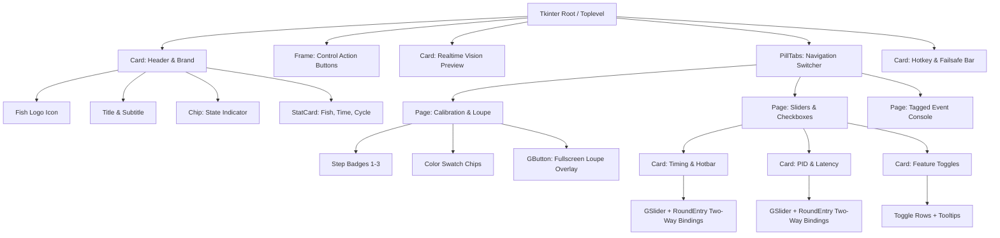

# UI_SPEC.md — UX/UI Design System & Component Specifications

**Project:** Fisch Macro Windows Desktop Automation  
**Lead Designer:** Member 69030377 (นางสาวพิชชาภา ภูววิไลเมธา — UX/UI Design)  
**Lead Developer:** Member 69030208 (นายฤทธิพร วงค์ป้อม — GUI & DB Integration)  
**Last Updated:** 2026-11-11  

---

## 1. Design Philosophy & Guidelines

The Fisch Macro desktop application follows a modern dark aesthetic inspired by contemporary gaming utilities and developer tools. The interface combines soft-cornered cards, smooth color gradients, and clear typographic contrast to maximize readability during active gaming sessions.

### Core Principles:
1. **Zero UI Blocking**: All long-running tasks (network authentication, heartbeat checks, vision capture, automation loops) execute on background threads and dispatch results asynchronously to the Tkinter main thread.
2. **Visual Hierarchy & State Clarity**: Automation state (IDLE, CASTING, WAITING, REELING, RESTING) is instantly recognizable through color-coded status chips and button states.
3. **Adaptive DPI Scaling**: All pixel dimensions pass through an automatic resolution scaler (`ui.sc()`) to ensure consistent visual sizing across 100%, 125%, 150%, and 4K displays.
4. **Ergonomic Controls**: Complex parameters (PID constants, tolerances, timing delays) offer both draggable continuous sliders and precise direct numeric entry fields.

---

## 2. Color System & Theme Tokens

The application employs a dual-theme architecture defined in `ui_kit.py`:

### 2.1 Theme `MAIN` (Dashboard & Admin Dialog)

| Token | Hex Value | Semantic Usage |
|---|---|---|
| `bg` | `#0e1427` | Deep navy application window background |
| `card` | `#161f3a` | Panel and card surface color |
| `card_line` | `#2a3760` | Subtle card outline border |
| `field` | `#1d2848` | Input field and control surface |
| `field_line` | `#34457a` | Input field resting border |
| `field_focus` | `#2de0c0` | Active input field focus ring |
| `fg` | `#e8eefc` | Primary high-contrast text |
| `muted` | `#8593b4` | Secondary labels and helper text |
| `dim` | `#566486` | Disabled text, icons, and idle badges |
| `accent` | `#2de0c0` | Bright teal highlight / active status |
| `ok` | `#34d399` | Success notifications and active reeling indicator |
| `warn` | `#fbbf24` | Waiting phase, timeouts, and failsafe warnings |
| `err` | `#ff7b8a` | Errors and emergency stop alerts |
| `info` | `#5fd4ff` | Informational log tags and casting indicator |

### 2.2 Theme `LOGIN` (Authentication Portal)

| Token | Hex Value | Semantic Usage |
|---|---|---|
| `bg` | `#1f1a63` | Deep violet window background |
| `bg_grad` | `("#4a3fc8", "#150f4a")` | Radial/linear card gradient fill |
| `card` | `#262183` | Authentication card surface |
| `card_line` | `#4f4ac4` | Glowing card border outline |
| `field` | `#2d2a94` | Rounded text box surface |
| `field_line` | `#6f6ee8` | Text box outline |
| `field_focus` | `#cfcfff` | Lavender input focus ring |
| `accent` | `#ffb27c` | Warm peach accent highlights |
| `btn["peach"]` | `("#f27a6b", "#fcbc7c")` | Primary gradient submit button |

---

## 3. Typography & Text Hierarchy

| Role | Face (Windows / Fallback) | Size / Weight | Sample Use |
|---|---|---|---|
| **App Title** | `Segoe UI` / `Tahoma` | 15pt Bold | Main header brand title |
| **Section Header** | `Segoe UI` / `Tahoma` | 12pt Bold | Card titles and modal dialog headings |
| **Stat KPI Value** | `Segoe UI` / `Tahoma` | 13pt Bold | Big numbers (Catches, Runtime, Cycle) |
| **Button Text** | `Segoe UI` / `Tahoma` | 10-11pt Bold | Action buttons (`▶ เริ่ม (F6)`, `LOGIN`) |
| **Field Labels** | `Segoe UI` / `Tahoma` | 9pt Regular | Form inputs, slider labels, table headers |
| **Muted Captions** | `Segoe UI` / `Tahoma` | 8pt Regular | Hotkey hints, subtitles, helper instructions |
| **Console Monospace** | `Consolas` / `Courier` | 8-9pt Regular | Color hex values, coordinates, logs |

---

## 4. Reusable Component Hierarchy

---

## 5. View Specifications

### 5.1 Authentication Window (`LoginWindow`)
- **Dimensions**: Auto-sized with dynamic margins (`P=26px`, `M=22px`). Centered on active monitor.
- **Header**: Circular avatar icon, spaced brand title `FISCH MACRO`, and portal description.
- **Tabs**: Smooth `PillTabs` switching between **SIGN IN**, **REGISTER**, and **FORGOT**.
- **Security Toggles**: Show Password toggle and Remember Me toggle with persistent client config.
- **Server Selector**: Collapsible backend address bar with instant `TEST` latency verification.

### 5.2 Macro Dashboard (`MacroDashboard`)
- **Header**: Live statistics for caught fish count, active runtime counter (`HH:MM:SS`), and cycle counter.
- **State Chip**: Dynamic pill badge with distinct color states:
  - `IDLE`: Slate gray (`#566486`)
  - `STARTING`: Amber (`#fbbf24`)
  - `CASTING`: Cyan (`#5fd4ff`)
  - `WAITING`: Amber (`#fbbf24`)
  - `REELING`: Emerald green (`#22c55e`)
  - `RESTING`: Mint teal (`#2de0c0`)
- **Live Preview**: Scaled 480px horizontal region showing raw pixels, detected fish center line (magenta), detected reel bar center line (cyan), and color mask highlights.
- **Calibration Loupe Overlay**: Fullscreen semi-transparent overlay featuring a 7x magnified pixel zoom loupe with exact RGB readout and crosshair region selection.
- **Settings Grid**: Two-column layout grouping casting parameters on the left and PD tracking parameters on the right.

### 5.3 Account Management Modal (`AccountDialog`)
- **Profile View**: Nickname, user ID, username, and role badge (`ผู้ดูแล` / `ผู้ใช้ทั่วไป`).
- **Self Service**: In-place password change requiring old password verification.
- **Admin Panel** (Restricted to `admin` role):
  - Interactive multi-column table displaying all registered users.
  - Action buttons: Suspend / Unsuspend, Force Reset Password, Delete User.
  - One-click Google Sheet synchronization button with progress feedback.

---

## 6. Accessibility & Responsive Verification

1. **Tooltip System (`Tip`)**: Hovering over any slider, input field, or toggle displays clear Thai guidance explaining the mechanical impact on automation.
2. **Keybindings**:
   - `F6`: Toggle automation start / stop.
   - `F7`: Emergency abort (failsafe).
   - `F8`: Instant minigame snapshot for calibration.
   - `Return`: Triggers active modal form submission.
   - `Esc`: Closes fullscreen calibration overlay and saves region.
